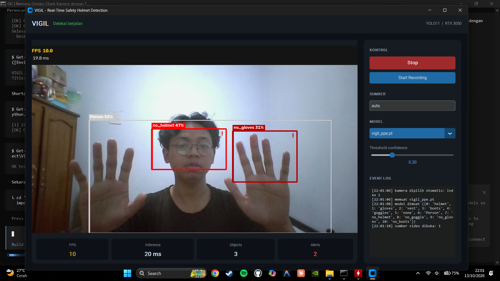
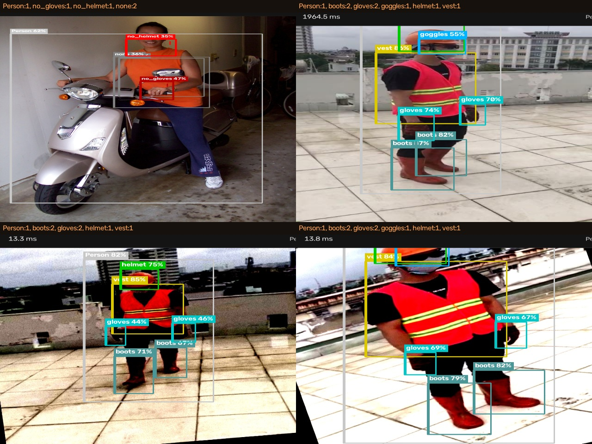
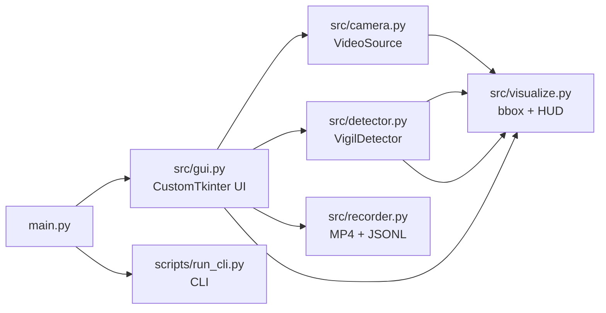

<div align="center">

# VIGIL

**Real-time Construction PPE Detection** — YOLO11 + PyTorch, 100% on-device

*Dari Latin* **vigilare** — *berjaga*. Kamera yang tidak pernah tidur, menandai
pelanggaran di detik yang sama — semua berjalan di GPU laptop 6 GB.


Deteksi helmet, rompi, sarung tangan, sepatu, kacamata keamanan — serta
menandai pekerja yang **tidak memakai** APD.


</div>

---

## 📊 Performa (NVIDIA RTX 3050 6GB)

Benchmark 200 inferensi, input 1280×720, FP16:

| Model | Params | Median | Mean | p95 | **FPS** | **mAP@50** |
|---|---:|---:|---:|---:|---:|---:|
| YOLO11n | 2.6 M | 9.5 ms | 11.5 ms | 22.6 ms | **86.6** | 0.594 |
| YOLO11s | 9.4 M | 10.3 ms | 11.9 ms | 21.3 ms | **84.3** | **0.624** ✅ |

> YOLO11s dipilih sebagai default: **+5% mAP dengan biaya kecepatan < 3%**.

### Per-kelas (YOLO11s, validation set)

| Kelas | Precision | Recall | mAP@50 |
|---|---:|---:|---:|
| Person | 0.823 | 0.921 | **0.918** |
| gloves | 0.804 | 0.787 | **0.852** |
| goggles | 0.756 | 0.787 | **0.840** |
| vest | 0.824 | 0.830 | **0.839** |
| boots | 0.778 | 0.728 | **0.817** |
| helmet | 0.785 | 0.806 | **0.783** |
| none | 0.536 | 0.568 | 0.548 |
| no_helmet | 0.425 | 0.411 | 0.399 |
| no_goggle | 0.548 | 0.414 | 0.396 |
| no_gloves | 0.504 | 0.364 | 0.329 |
| no_boots | 0.129 | 0.250 | 0.142 |

**Catatan jujur:** kelas `no_*` (pelanggaran) memang jauh lebih lemah daripada
kelas `*` (terpasang). Ini bukan kebetulan — "tidak memakai" adalah kondisi
negatif yang harus disimpulkan dari tidak-adanya objek, jauh lebih ambigu secara
visual daripada melihat helmeter secara langsung. Pada dataset ini `no_boots`
juga hanya punya 88 instance di train (paling langka). Ini limitasi dataset,
bukan limitasi arsitektur.

### Preview aplikasi



GUI desktop (CustomTkinter) berjalan real-time dari webcam: bounding box per
kelas, HUD FPS/inference, panel statistik, dan event log untuk tiap pelanggaran.
Kamera **otomatis dipilih** — sistem mengukur brightness tiap kamera dan
melewati yang tertutup privacy shutter (frame hitam).

### Hasil deteksi pada test set



---

## 🎯 Fitur

- Deteksi real-time dari **webcam / video / gambar / folder**
- GUI desktop dark-theme (CustomTkinter) + **CLI**
- Rekam hasil deteksi ke **MP4** + **event log JSONL**
- FP16 inference di GPU (2× lebih cepat daripada FP32)
- **Auto-pilih kamera**: mendeteksi kamera yang benar-benar berisi gambar,
  melewati yang tertutup privacy-shutter (frame hitam)
- Slider threshold confidence saat runtime
- Inferensi di worker thread → UI tidak freeze
- **11 kelas**, termasuk 4 kelas pelanggaran

### Kelas yang dideteksi

| APD terpasang | Pelanggaran | Lain |
|---|---|---|
| `helmet` `vest` `gloves` `boots` `goggles` | `no_helmet` `no_goggle` `no_gloves` `no_boots` | `Person` `none` |

---

## 🏗️ Arsitektur



Pemisahan tanggung jawab yang jelas: logika deteksi, I/O kamera, visualisasi,
dan perekaman saling independen — masing-masing bisa diuji tanpa GUI.

---

## ⚡ Cara Cepat

Sudah punya `VIGIL.exe`?

```powershell
.\create_shortcut.ps1     # buat shortcut di Desktop + Start Menu
```

Kalau belum, jalankan sekali:
```powershell
.\.venv\Scripts\python.exe scripts\build_exe.py
```

## 🚀 Instalasi dari source

```powershell
# 1. Virtual environment
python -m venv .venv
.\.venv\Scripts\Activate.ps1

# 2. PyTorch (CUDA 12.8)
pip install torch torchvision --index-url https://download.pytorch.org/whl/cu128

# 3. Dependency lain
pip install -r requirements.txt
```

## 💻 Penggunaan

```powershell
# GUI
python main.py

# CLI - webcam
python scripts/run_cli.py --weights weights\vigil_ppe.pt --source 0

# CLI - video + rekam + preview
python scripts/run_cli.py --weights weights\vigil_ppe.pt --source video.mp4 --record --show

# Batch - seluruh folder gambar
python scripts/run_cli.py --weights weights\vigil_ppe.pt --source data\images\test --record

# Cek kamera yang tersedia
python scripts\list_cameras.py
```

## 🎓 Training

```powershell
# YOLO11s (default, ~25 menit di RTX 3050)
python scripts\train.py --data data\data.yaml --model yolo11s.pt --epochs 60 --batch 12

# YOLO11n (ringan, ~15 menit)
python scripts\train.py --data data\data.yaml --model yolo11n.pt --epochs 60 --batch 16

# Bandingkan hasil semua run
python scripts\compare_models.py
```

Script training otomatis menyalin model terbaik ke `weights/` **hanya jika mAP-nya
meningkat**, jadi `vigil_ppe.pt` selalu berisi model terbaik.

## 📁 Struktur Folder

```
VIGIL-AI\
├─ main.py                  # entry point GUI
├─ activate_env.ps1         # aktivasi env + alias (hg, hgcli)
├─ src\
│  ├─ config.py             # path, threshold, warna kelas
│  ├─ detector.py           # wrapper YOLO + statistik
│  ├─ camera.py             # webcam / video / gambar / folder
│  ├─ recorder.py           # MP4 writer + event log
│  ├─ visualize.py          # bounding box, label, HUD
│  └─ gui.py                # CustomTkinter
├─ scripts\
│  ├─ train.py              # training runner
│  ├─ run_cli.py            # CLI detector
│  ├─ list_cameras.py       # deteksi kamera
│  └─ compare_models.py     # tabel perbandingan model
├─ data\                    # dataset (YOLO format)
├─ runs\                    # output training (grafik, confusion matrix)
├─ weights\                 # model .pt + metrics.json
├─ output\                  # MP4 + JSONL hasil deteksi
└─ docs\                    # screenshot & demo
```

---

## 📦 Dataset

**Ultralytics Construction-PPE** — 1.416 gambar (1.132 train / 143 val / 141 test),
11 kelas, foto pekerja konstruksi nyata dengan maupun tanpa APD.

- Sumber: <https://docs.ultralytics.com/datasets/detect/construction-ppe/>
- Lisensi: AGPL-3.0
- Link: <https://github.com/ultralytics/assets/releases/download/v0.0.0/construction-ppe.zip>

Unduh langsung tanpa akun:
```powershell
curl.exe -L -o construction-ppe.zip https://github.com/ultralytics/assets/releases/download/v0.0.0/construction-ppe.zip
Expand-Archive construction-ppe.zip -DestinationPath data
```

---

## ⚙️ Lingkungan

Semua instalasi & cache diarahkan ke drive D: agar tidak menyentuh drive C:
`PIP_CACHE_DIR`, `TEMP`, `TMP`, `TORCH_HOME`, `HF_HOME`, `YOLO_CONFIG_DIR`.

## 📝 Lisensi

MIT — lihat [LICENSE](LICENSE).
Dataset mengikuti lisensi masing-masing pemilik (AGPL-3.0).